  

  
  
  
  

### 01 / ENGINEERING FOCUS

Exploring embedded systems, connected devices and edge intelligence — from low-level mechanisms to practical tools and open-source collaboration.

Domain | Engineering practice
:--- | :---
**SYSTEMS** | Boot flows, device drivers, real-time systems and embedded Linux
**CONNECTIVITY** | Automotive communication, industrial networks, protocol integration and device updates
**EDGE &amp; TOOLS** | On-device inference, build tooling, system debugging and code quality

### 02 / TOOLBOX

  
  
  
  
  
  
  
  

Cortex-M · RISC-V · STM32 · ESP32 · RTOS · Linux BSP · AUTOSAR · CAN · SOME/IP

### 03 / OPEN SOURCE TELEMETRY

  

  
  

  
  

  

How these cards update

Cards are generated from GitHub data and refresh periodically. Service and image caches may delay updates. Language charts describe repository composition; contribution counts follow GitHub’s contribution rules.

### 04 / CONTRIBUTION CIRCUIT

<picture>
  <source media="(prefers-color-scheme: dark)" srcset="https://raw.githubusercontent.com/yeyue1/yeyue1/output/github-snake-dark.svg" />
  
</picture>

Contribution snake refreshes daily via GitHub Actions.

---

<code>READ THE DATASHEET → TRACE THE SIGNAL → UNDERSTAND THE SYSTEM</code>

