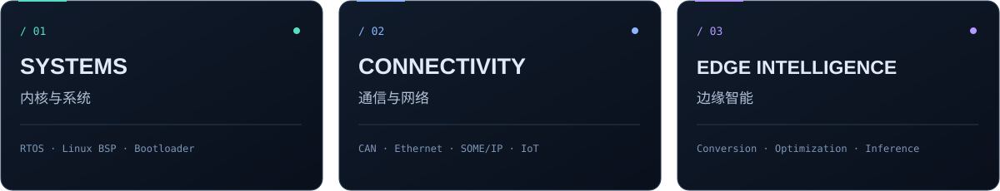

  

  
  
  
  

### 01 / ENGINEERING FOCUS

围绕嵌入式系统、通信与边缘智能持续实践，关注底层机制、工程实现与开源协作。

方向 | 工程实践
:--- | :---
**SYSTEMS** | 启动链路、驱动、实时系统与嵌入式 Linux
**CONNECTIVITY** | 车载通信、工业组网、协议集成与设备升级
**EDGE &amp; TOOLS** | 端侧推理、构建工具、系统调试与代码质量

### 02 / TOOLBOX

  
  
  
  
  
  
  
  

Cortex-M · RISC-V · STM32 · ESP32 · RTOS · Linux BSP · AUTOSAR · CAN · SOME/IP

### 03 / OPEN SOURCE TELEMETRY

  

  
  

  
  

  

数据更新说明 / How these cards update

统计卡由服务端根据 GitHub 数据生成，受服务刷新频率与 GitHub 图片缓存影响，更新存在延迟。语言分布描述仓库代码组成；贡献数据按 GitHub 的统计规则计算。

### 04 / CONTRIBUTION CIRCUIT

<picture>
  <source media="(prefers-color-scheme: dark)" srcset="https://raw.githubusercontent.com/yeyue1/yeyue1/output/github-snake-dark.svg" />
  
</picture>

Contribution snake refreshes daily via GitHub Actions.

---

<code>READ THE DATASHEET → TRACE THE SIGNAL → UNDERSTAND THE SYSTEM</code>

